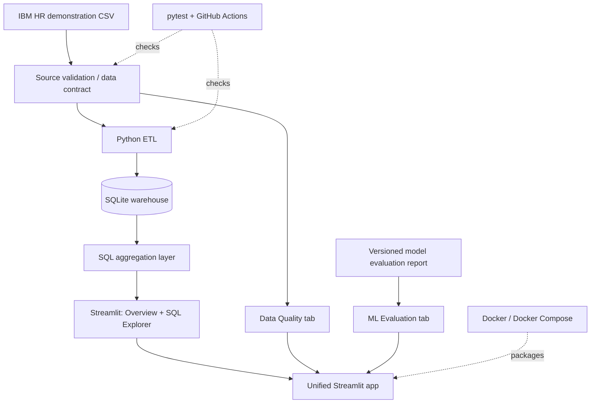

# Workforce Intelligence Platform

**An end-to-end, zero-cost workforce analytics portfolio project** connecting data quality, ETL, SQLite, SQL analytics, interactive dashboards, and reproducible machine-learning evaluation.

[](https://workforce-intelligence-erenkyz.streamlit.app)
[](https://github.com/Erenkyz/Employee_Burnout_and_Turnover_Prediction/actions/workflows/ci.yml)


**[Launch the live application](https://workforce-intelligence-erenkyz.streamlit.app)** · **[Browse the source](https://github.com/Erenkyz/Employee_Burnout_and_Turnover_Prediction)** · **[View CI runs](https://github.com/Erenkyz/Employee_Burnout_and_Turnover_Prediction/actions)**

> **Responsible-use notice:** This project uses the public IBM HR attrition demonstration dataset. Its insights are descriptive, and its models are exploratory. It is **not** validated for employment decisions, individual worker assessment, or clinical burnout diagnosis.

## The problem and solution

A machine-learning notebook alone does not demonstrate how data moves through a dependable analytics product. This project expands the original HR attrition notebook into a **reproducible analytics workflow**: validate the source, load a curated SQL warehouse, calculate group-level KPIs, publish an interactive dashboard, and document model evaluation separately.

| Engineering | Analytics | Delivery |
| --- | --- | --- |
| Data contract and quality gates | SQL-based segment comparisons | Streamlit web application |
| Repeatable CSV-to-SQLite ETL | Attrition KPIs and filters | Docker Compose deployment |
| Automated tests | Documented baseline comparison | GitHub Actions CI |

## Architecture



**Design choices:** SQLite keeps the workflow reproducible without a paid cloud service. The curated warehouse stores a limited set of analytics fields and excludes the source employee identifier. The dashboard queries aggregate data; it does not generate live employee-level risk scores. The ML tab displays a saved experimental report instead of retraining models on every page load.

## Explore the live dashboard

| Section | What it demonstrates |
| --- | --- |
| **Overview** | Overall records, recorded departures, attrition rate, and department comparisons |
| **SQL Explorer** | SQL-backed aggregation by department, job role, overtime, satisfaction, and work–life balance; minimum group-size filter and aggregate CSV export |
| **Data Quality** | Source validation status, dataset dimensions, and missing-cell checks |
| **ML Evaluation** | Versioned results from a controlled baseline comparison, including F1, average precision, ROC-AUC, and Brier score |

### Dataset snapshot

| Metric | Value |
| --- | ---: |
| Employee records | 1,470 |
| Recorded departures | 237 |
| Overall attrition rate | 16.1% |
| Department categories | 3 |

These are characteristics of the demonstration dataset, not findings about a real organization.

## Reproducible model evaluation

The V2 comparison uses a shared **16-feature whitelist** and a stratified **60% train / 20% validation / 20% test** split (882 / 294 / 294 observations). Threshold selection is performed on validation data; reported comparisons use the held-out test split.

| Held-out metric | Class-weighted logistic | SMOTEENN + logistic | Dummy prior |
| --- | ---: | ---: | ---: |
| Average precision | **0.518** | 0.470 | 0.160 |
| ROC-AUC | **0.794** | 0.760 | 0.500 |
| F1 | **0.513** | 0.459 | 0.000 |
| Brier score (lower is better) | 0.184 | 0.206 | **0.134** |

**Interpretation:** In this one split, class-weighted logistic performed better on F1 and ranking metrics than the SMOTEENN variant. Neither model beat the dummy prior on Brier score; predicted probabilities should **not** be treated as well calibrated. The SMOTEENN experiment also has a methodological limitation: interpolation after one-hot encoding can produce implausible synthetic feature combinations.

See [controlled comparison](docs/MODEL_COMPARISON_RESULTS.md), [stability analysis](docs/MODEL_STABILITY_RESULTS.md), and the [versioned report used by the app](reports/model_comparison_demo.json). These are exploratory, not production model validation results.

## Technology stack

| Layer | Technologies |
| --- | --- |
| Data processing and validation | Python, pandas |
| Storage and querying | SQLite, SQL |
| Machine learning evaluation | scikit-learn, imbalanced-learn |
| Visualization and application | Streamlit, Plotly |
| Testing and automation | pytest, GitHub Actions |
| Packaging and deployment | Docker, Docker Compose, Streamlit Community Cloud |

## Run locally

**Requirements:** Python 3.11, Git, and a terminal. No paid API or cloud account required.

```bash
git clone https://github.com/Erenkyz/Employee_Burnout_and_Turnover_Prediction.git
cd Employee_Burnout_and_Turnover_Prediction
python -m venv .venv
```

Activate the virtual environment:

**Windows PowerShell**
```powershell
.\.venv\Scripts\Activate.ps1
```

**macOS / Linux**
```bash
source .venv/bin/activate
```

Install dependencies, run tests, and launch the app:

```bash
python -m pip install -r requirements-dev.txt
python -m pytest -q
python -m streamlit run app.py
```

Open **http://localhost:8501**. The application validates the CSV and builds its local SQLite warehouse when needed.

To build the warehouse separately:

```bash
python scripts/build_warehouse.py
```

To reproduce model experiments locally:

```bash
python scripts/evaluate_baseline.py
python scripts/compare_models.py
python scripts/evaluate_stability.py
```

Generated outputs in `data/` are local artifacts and are not required for the live ML Evaluation tab.

### Docker (alternative)

With Docker Desktop running:

```bash
docker compose up --build -d
docker compose ps
```

Open **http://localhost:8501**. Stop the container with `docker compose down`.

See [Docker deployment guide](docs/DOCKER_DEPLOYMENT.md).

## Repository guide

| Location | Purpose |
| --- | --- |
| `app.py` | Unified dashboard entry point |
| `src/workforce_intelligence/data_quality.py` | Dataset validation and quality contract |
| `src/workforce_intelligence/warehouse.py` | SQLite ETL |
| `src/workforce_intelligence/sql_analytics.py` | Parameterized aggregate queries |
| `src/workforce_intelligence/model_validation.py` | Reproducible baseline evaluation |
| `src/workforce_intelligence/model_comparison.py` | Baseline-versus-SMOTEENN comparison |
| `src/workforce_intelligence/model_stability.py` | Repeat-split stability analysis |
| `scripts/` | Command-line workflows |
| `reports/model_comparison_demo.json` | Versioned metrics shown in the live app |
| `tests/` | Automated quality, SQL, ETL, and ML tests |
| `.github/workflows/ci.yml` | Python test and Docker build checks |
| `Dockerfile`, `compose.yaml` | Container packaging |
| `docs/` | Architecture, model audits, evaluations, and roadmap |

The original `Employee_Burnout_and_Turnover_Prediction.ipynb`, `Project_app.py`, and older dashboards are retained for historical comparison; **`app.py` is the current entry point**. Original notebook metrics are not directly comparable with V2 due to differing data and evaluation choices.

## What this project demonstrates

- **Data Engineering:** Data contracts, quality checks, ETL, relational storage, reproducible builds, and CI.
- **Data Analytics:** SQL aggregation, segmentation, KPI interpretation, and interactive reporting.
- **Business Analysis:** Turning a broad workforce question into measurable metrics, clear reporting, and explicit data limitations.
- **Machine Learning:** Controlled comparisons, held-out evaluation, threshold selection, and transparent discussion of model limitations.

## Limitations and next steps

The source is a static demonstration dataset: there are no production ingestion feeds, historical snapshots, real-time monitoring, or external organizational validation. Group-level differences are associations, not causal explanations. The current ML experiments are not calibrated or validated for operational decisions.

Potential future engineering extensions include scheduled ingestion, warehouse migrations, observability, and richer aggregate reporting. These are **future directions, not currently implemented features**.

---

**Built as a portfolio project.** [Live demo](https://workforce-intelligence-erenkyz.streamlit.app) · [Architecture notes](docs/DATA_ARCHITECTURE.md) · [Technical audit](docs/TECHNICAL_AUDIT.md)
